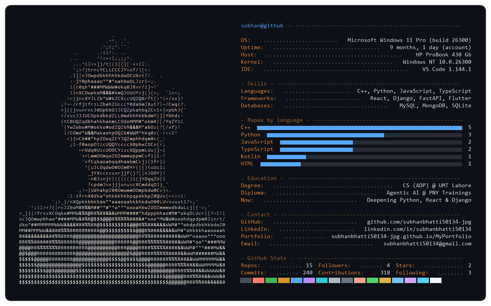

<div align="center">
  
</div>

---

### `$ whoami`


```text
name       Subhan Bhatti
role       CS (ADP) student @ University of Management and Technology, Lahore
focus      C++ / Python / Web developer — AI & agentic systems
education  Agentic AI Diploma — PNY Trainings
history    Ex Software Dev Intern @ Arch Technologies (C++)
           Ex Digital Marketing Manager @ Karachi House
building   Python, React, Node.js, Django, FastAPI & AI pipelines
status     open to internships, collaborations & open-source contributions
```

<br clear="all">

> *"Build things that matter — one commit at a time."*

---

### `$ cat now.txt`

```text
✅ Deepening Python, React & Django — building real-world full-stack projects
🚀 Exploring AI/Agentic systems, RAG pipelines & backend architecture
🤝 Open to internships, collaborations & open-source contributions
```

---

### `$ ls ~/projects`

<table>
  <tr>
    <td width="50%">
      <a href="https://github.com/subhanbhatti50134-jpg/app-sweeper">
        </a>
      <br>
      <sub><b><a href="https://github.com/subhanbhatti50134-jpg/app-sweeper">app-sweeper</a></b> — zero-dependency Linux app uninstaller (Python)</sub>
    </td>
    <td width="50%">
      <a href="https://github.com/subhanbhatti50134-jpg/nyvexa">
        </a>
      <br>
      <sub><b><a href="https://github.com/subhanbhatti50134-jpg/nyvexa">nyvexa</a></b> — full-stack AI assistant: streaming chat, RAG & agents (FastAPI)</sub>
    </td>
  </tr>
  <tr>
    <td width="50%">
      <a href="https://github.com/subhanbhatti50134-jpg/GoldSilverPOS">
        </a>
      <br>
      <sub><b><a href="https://github.com/subhanbhatti50134-jpg/GoldSilverPOS">GoldSilverPOS</a></b> — jewellery shop POS for Android (Kotlin, Compose)</sub>
    </td>
    <td width="50%">
      <a href="https://github.com/subhanbhatti50134-jpg/Ruppee-Pulse">
        </a>
      <br>
      <sub><b><a href="https://github.com/subhanbhatti50134-jpg/Ruppee-Pulse">Ruppee-Pulse</a></b> — live Binance trading & PKR analytics dashboard</sub>
    </td>
  </tr>
  <tr>
    <td width="50%">
      <a href="https://github.com/subhanbhatti50134-jpg/vertex-tech">
        </a>
      <br>
      <sub><b><a href="https://github.com/subhanbhatti50134-jpg/vertex-tech">vertex-tech</a></b> — creative agency site (React, Three.js, GSAP)</sub>
    </td>
    <td width="50%">
      <a href="https://github.com/subhanbhatti50134-jpg/StreamCam">
        </a>
      <br>
      <sub><b><a href="https://github.com/subhanbhatti50134-jpg/StreamCam">StreamCam</a></b> — camera streaming for terminal, desktop & Android</sub>
    </td>
  </tr>
  <tr>
    <td width="50%">
      <a href="https://github.com/subhanbhatti50134-jpg/MyPortfolio">
        </a>
      <br>
      <sub><b><a href="https://github.com/subhanbhatti50134-jpg/MyPortfolio">MyPortfolio</a></b> — developer portfolio built with Vite + React</sub>
    </td>
    <td width="50%">
      <a href="https://github.com/subhanbhatti50134-jpg/snj-gold-lab-web-app">
        </a>
      <br>
      <sub><b><a href="https://github.com/subhanbhatti50134-jpg/snj-gold-lab-web-app">snj-gold-lab-web-app</a></b> — gold inventory management (React, FastAPI, Postgres)</sub>
    </td>
  </tr>
  <tr>
    <td width="50%">
      <a href="https://github.com/subhanbhatti50134-jpg/Saleem-Nadeem-Jewellers-Rate-portal">
        </a>
      <br>
      <sub><b><a href="https://github.com/subhanbhatti50134-jpg/Saleem-Nadeem-Jewellers-Rate-portal">Saleem-Nadeem rate portal</a></b> — gold & silver rates for a jeweller's storefront</sub>
    </td>
    <td width="50%">
      <a href="https://github.com/subhanbhatti50134-jpg/ATM-Stimulation">
        </a>
      <br>
      <sub><b><a href="https://github.com/subhanbhatti50134-jpg/ATM-Stimulation">ATM-Stimulation</a></b> — PIN-protected ATM simulator (C++ OOP)</sub>
    </td>
  </tr>
  <tr>
    <td width="50%">
      <a href="https://github.com/subhanbhatti50134-jpg/Dice-Rolling-Game">
        </a>
      <br>
      <sub><b><a href="https://github.com/subhanbhatti50134-jpg/Dice-Rolling-Game">Dice-Rolling-Game</a></b> — dice game with snake eyes & boxcars detection (C++)</sub>
    </td>
    <td width="50%">
      <a href="https://github.com/subhanbhatti50134-jpg/Number-Guessing-Game">
        </a>
      <br>
      <sub><b><a href="https://github.com/subhanbhatti50134-jpg/Number-Guessing-Game">Number-Guessing-Game</a></b> — number guessing CLI game (C++)</sub>
    </td>
  </tr>
  <tr>
    <td width="50%">
      <a href="https://github.com/subhanbhatti50134-jpg/Student-Management-System-using-OOP-C-">
        </a>
      <br>
      <sub><b><a href="https://github.com/subhanbhatti50134-jpg/Student-Management-System-using-OOP-C-">Student-Management-System</a></b> — student records with OOP & file handling (C++)</sub>
    </td>
    <td width="50%">
      <a href="https://github.com/subhanbhatti50134-jpg/To-Do-List-Application">
        </a>
      <br>
      <sub><b><a href="https://github.com/subhanbhatti50134-jpg/To-Do-List-Application">To-Do-List-Application</a></b> — console to-do list (C++)</sub>
    </td>
  </tr>
</table>

---

### `$ cat stack.txt`

<p align="center">
  <a href="https://subhanbhatti50134-jpg.github.io/MyPortfolio/">
    
  </a>
</p>

---

### `$ tail -f activity.log`

<p align="center">
  
</p>

<p align="center">
  
</p>

---

### `$ ./connect.sh`

[](https://subhanbhatti50134-jpg.github.io/MyPortfolio/)
[](https://www.linkedin.com/in/subhanbhatti50134/)
[](mailto:subhanbhatti50134@gmail.com)
[](https://github.com/subhanbhatti50134-jpg)

---

```text
> "First, solve the problem. Then, write the code."
                                                    — John Johnson
```

*Snake & stats refresh automatically via GitHub Actions.*
